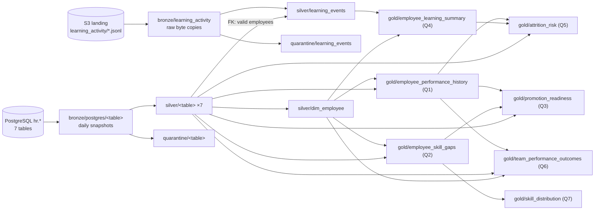

# talent-pipeline — Data Lineage & Source-to-Target Mapping

How every dataset and column in the lake is derived, so any number in a Gold
table can be traced back to the source record it came from.

## 1. How lineage is captured

| Level | Question it answers | Where it lives |
|---|---|---|
| **Run** | Which run produced this, with what code, and did it succeed? | `s3://<lake>/_runs/run_date=YYYY-MM-DD/<run_id>.json` (one per run, failed runs included); `_runs/latest.json` points at the last complete successful run |
| **Dataset** | Which datasets is this table built from? | `lineage` section of every run manifest, generated by `dataset_lineage()` from the same structures the pipeline executes (`SOURCE_TABLES`, `FOREIGN_KEYS`, `GOLD_TABLES`) |
| **Row** | Which run wrote this row, and which source record is it? | `_`-prefixed columns on every row (table below) |

Lineage columns (the `_` prefix marks "added by the pipeline, not the source"):

| Column | Layers | Meaning |
|---|---|---|
| `_run_id` | Bronze, Silver, Gold, Quarantine | Run that wrote the row (e.g. `20261015T045150Z-0d5c3582`) |
| `_ingested_at` | Bronze (tables), Silver (tables) | UTC time the source snapshot was taken |
| `_source` | Bronze (tables), Silver (tables), Quarantine | Source table, e.g. `postgres://localhost/postgres/hr.employees` |
| `_bronze_run_id` | Silver (tables), Quarantine (tables) | Run that ingested the Bronze snapshot this row was validated from |
| `_source_file`, `_source_line` | Silver/Quarantine (`learning_events`) | Exact Bronze JSONL file and line number |
| `_as_of_date` | Gold | Logical run date used for date-relative metrics (tenure, "recent" learning) |
| S3 metadata `run-id`, `source`, `ingested-at` | Bronze `learning_activity` files | Raw files can't gain columns, so lineage is stored as object metadata |

Gold tables declare their inputs in `GOLD_TABLES`, and `compute_gold()` passes each
builder **only** its declared inputs, so an undeclared dependency fails immediately
instead of silently making the lineage wrong (`tests/test_lineage.py`).

## 2. Dataset lineage (layer summary)

The complete 40-node graph is in every run manifest; regenerate a diagram with
`python -c "import job; print(job.lineage_mermaid(job.Settings.from_env()))"`.

Exact Gold inputs (from `GOLD_TABLES`):

| Gold table | Inputs |
|---|---|
| `employee_performance_history` | silver/performance_reviews, silver/dim_employee |
| `employee_skill_gaps` | silver/competency_assessments, silver/competencies, silver/dim_employee |
| `promotion_readiness` | silver/dim_employee, silver/talent_review, gold/employee_performance_history, gold/employee_skill_gaps |
| `employee_learning_summary` | silver/learning_events, silver/dim_employee |
| `attrition_risk` | silver/dim_employee, silver/talent_review, gold/employee_performance_history, gold/employee_learning_summary |
| `team_performance_outcomes` | silver/teams, silver/dim_employee, gold/employee_performance_history, silver/projects |
| `skill_distribution` | gold/employee_skill_gaps |

## 3. Source → Bronze

**PostgreSQL tables** → `bronze/postgres/<table>/ingest_date=<run_date>/part-0.parquet`

All 7 tables are read in one `REPEATABLE READ` read-only transaction (a consistent
snapshot) and stored **unchanged**: same column names, same values, types as returned
by the driver (`INTEGER`→int64, `TEXT`→string, `DATE`→date, `NUMERIC(5,2)`→exact decimal).
Added: `_run_id`, `_ingested_at`, `_source`, and partition column `ingest_date`.

**Landing JSONL** `s3://<landing>/learning_activity/year=/month=/day=/*.jsonl`
→ `bronze/learning_activity/year=/month=/day=/*.jsonl`

Server-side byte-for-byte copy (size + ETag verified). Keys must match
`learning_activity/year=YYYY/month=MM/day=DD/<file>.jsonl`; others are skipped with a warning.
Already-ingested identical files are skipped (incremental); a landing file whose bytes
changed after ingestion is **not** overwritten (Bronze is immutable) and is reported as a conflict.
An **empty (0-byte) landing file** is still ingested (Bronze stays a faithful copy) but logged as a warning
— usually a failed or partial delivery — and counted as `learning_files_empty` in the run manifest. The
reference dataset has one: `year=2025/month=09/day=03/events-000.jsonl`.

## 4. Bronze → Silver

Every value passes through `coerce()` (trim → strict type conversion) and the entity's
`Contract`. Rows failing any check go to `quarantine/<entity>/run_date=<run_date>/` with
**all** failure reasons. `rows read == silver rows + quarantined rows` is enforced per entity.

### 4.1 Source tables (names unchanged; types enforced)

| Entity | Column → type | Rules beyond type/required |
|---|---|---|
| `teams` | team_id int · name str · department str | unique team_id |
| `competencies` | competency_id int · name str · category str | category ∈ {Technical, Leadership, Domain} |
| `employees` | employee_id int · first_name, last_name, email str · team_id int · job_level str · hire_date **date** | email format · job_level ∈ 7 known levels · hire_date ≤ run date · team_id ∈ valid teams |
| `projects` | project_id int · name str · team_id int · outcome_status str · outcome_score **decimal→float** | status ∈ {on-time, delayed, at-risk, cancelled} · 0 ≤ score ≤ 100 · team_id ∈ valid teams |
| `performance_reviews` | review_id, employee_id int · review_period str · rating int · manager_comment str (optional) · submitted_date date | period `YYYY-H1/H2` · 1 ≤ rating ≤ 5 · submitted ≤ run date · one review per employee per period · employee ∈ valid employees |
| `competency_assessments` | assessment_id, employee_id, competency_id, proficiency_level, required_level int · assessed_date date | levels 1–5 · assessed ≤ run date · employee & competency valid |
| `talent_review` | employee_id int · review_cycle, potential_rating, promotion_readiness, attrition_risk str | cycle `YYYY-H1/H2` · ratings ∈ {Low, Medium, High} · readiness ∈ {Ready Now, 1-2 Years, Not Ready} · employee valid |

Lineage: Bronze `_run_id` → `_bronze_run_id`; `_ingested_at`, `_source` carried; new `_run_id`;
`ingest_date` dropped.

### 4.2 `learning_events` (from raw JSONL)

| Source field | Silver column | Transformation |
|---|---|---|
| *(line)* | — | `json.loads`; unparseable → quarantine `malformed_json`; non-object → `not_a_json_object` |
| `event_id` | `event_id` (str) | must match `EV` + 10 digits; **first occurrence wins**, later copies → `duplicate_event_id` |
| `employee_id` (string in source) | `employee_id` (**int**) | cast; must exist in valid Silver employees |
| `event_date` (a timestamp) | **renamed** `event_ts` (timestamp) | strict `YYYY-MM-DDTHH:MM:SS`; must fall on the file's `year/month/day` partition |
| — | `event_date` (**derived**, date) | date part of `event_ts` |
| `event_type` | `event_type` | ∈ 7 known types |
| `course_name` | `course_name` | required |
| `text` — or `notes` (**drift**, file 2024-09-03) | `text` | `notes` mapped onto `text` (`LEARNING_FIELD_ALIASES`), logged as schema drift |
| `score` | `score` (int) | 0–100; required for `quiz_attempted`/`quiz_passed`, must be null for other known types |
| — | `recorded_before_hire` (**derived**, bool) | `event_date` < the employee's `hire_date` (see 4.4) |
| — | `event_year`, `event_month` (**derived**) | partition columns (`silver/learning_events/event_year=/event_month=/`) |

### 4.3 `dim_employee` (conformed dimension)

`employees` ⋈ `teams` on `team_id` (many-to-one, validated): `full_name` = first + " " + last;
`teams.name` → **renamed** `team_name`; `department` from teams; `tenure_years` =
(run date − hire_date) / 365.25, 1 decimal.

### 4.4 Cross-table consistency: records dated before hire (flagged, not quarantined)

A record can be valid on its own yet impossible against another table. Silver adds
`recorded_before_hire` (bool) by comparing a record's date with the employee's `hire_date`:

| Entity | Date compared | Flagged when |
|---|---|---|
| `performance_reviews` | end of `review_period` (`H1` → 30 Jun, `H2` → 31 Dec) | the period **ended** before hire (hired mid-period = worked part of it = not flagged) |
| `competency_assessments` | `assessed_date` | before hire |
| `learning_events` | `event_date` | before hire |

These rows are **kept**: the data cannot show whether the record or the hire date is wrong
(`hire_date` may mean "joined current role") — an open question for the HR data owner. Counts are
logged as warnings and recorded in the run manifest (`<entity>_before_hire`). Reference data:
666 reviews (16.7 %), 234 assessments (5.9 %), 5,161 learning events (17.5 %); 99 % of employees
hired since 2024 are affected vs 3 % of earlier hires.

## 5. Silver → Gold (aggregations & business rules)

Definitions live as constants in `job.py`: `CRITICAL_GAP_LEVELS = 2`, `STRONG_RATING = 4`,
`LEARNING_RECENT_DAYS = 180`. All employee-grain tables start from `dim_employee`
(left joins), so no employee is dropped. Common employee columns: `employee_id, full_name,
job_level, hire_date, tenure_years, team_id, team_name, department`.

| Gold table (grain) | Column | Derivation |
|---|---|---|
| **employee_performance_history** (employee × review_period) | `period_start` | `YYYY-H1` → Jan 1, `YYYY-H2` → Jul 1 |
| | `review_number`, `is_latest_review` | order of `period_start` per employee |
| | `recorded_before_hire` | carried from Silver (4.4) |
| | `previous_rating`, `rating_change` | previous review's rating; `rating − previous_rating` |
| **employee_skill_gaps** (employee × competency) | — | latest assessment per pair (by `assessed_date`, then `assessment_id`) |
| | `gap_levels` | `required_level − proficiency_level` (positive = below requirement) |
| | `gap_status`, `is_critical_gap` | ≥2 critical · 1 below · 0 meets · <0 exceeds |
| | `recorded_before_hire` | carried from Silver (4.4) |
| | `competency_name`, `category` | from `competencies` (`name` **renamed**) |
| **promotion_readiness** (employee) | `latest_rating`, `latest_review_period` | from history where `is_latest_review` |
| | `critical_gap_count` | count of `is_critical_gap` per employee |
| | `promotion_tier` | `ready_strong` = High + Ready Now + latest ≥4 · `ready` = High + Ready Now · `pipeline` = High + 1-2 Years · else `not_ready` |
| | `latest_review_before_hire` | the review deciding the tier is flagged (4.4) |
| **employee_learning_summary** (employee) | `enrollments` … `certifications_earned` | count of events per `event_type` |
| | `total_events`, `events_last_180d` | all events; events with `event_ts` ≥ run date − 180 days |
| | `distinct_courses_completed`, `completed_courses` | from `course_completed` events (`"; "`-joined, sorted) |
| | `avg_quiz_score` | mean `score` over scored events, 1 decimal |
| | `first_/last_activity_date` | min/max `event_date` |
| | `events_before_hire` | count of flagged events (4.4) |
| **attrition_risk** (employee) | `hr_attrition_risk` | `talent_review.attrition_risk` (**renamed**) |
| | `rating_trend` | declining / stable / improving / unknown (from `rating_change`) |
| | `performance_risk` | drop ≥2 → High · drop 1 → Medium · flat/up → Low · <2 reviews → Unknown |
| | `combined_risk` | higher of HR and performance risk (Unknown = no evidence) |
| | `risk_alignment`, `hidden_risk` | which signal is higher; performance High while HR says Low |
| | `trend_uses_pre_hire_review` | either of the two reviews behind the trend is flagged (4.4) |
| **team_performance_outcomes** (team) | `headcount` | employees per team |
| | `avg_latest_rating`, `avg_rating_change`, `high_performer_rate` | over each member's latest review; share with rating ≥4 |
| | `project_count`, `avg_project_outcome_score`, `projects_<status>`, `on_time_rate` | from `projects`; on-time / total |
| **skill_distribution** (competency × department) | `employees_assessed`, `avg_proficiency`, `avg_required` | over `employee_skill_gaps` |
| | `meeting_requirement_rate`, `critical_gaps` | share with gap ≤0; count of critical gaps |
| | `proficiency_level_1..5` | head-counts per level (re-aggregate exactly to category/org level) |

Gold is validated before anything is published: unique grain, expected row counts,
and reconciliations (team headcounts = employees, learning totals = Silver events,
assessed counts = skill-gap rows, project counts = projects, flagged pre-hire reviews and
events = Silver flags).

## 6. Quarantine reason codes

| Code pattern | Meaning |
|---|---|
| `malformed_json`, `not_a_json_object` | line couldn't be parsed into a record |
| `missing_<col>` | required field null/blank |
| `bad_type_<col>` | value present but not convertible (e.g. `"yesterday"` as a timestamp) |
| `not_allowed_<col>` | value outside the allowed set |
| `out_of_range_<col>` | numeric value outside its bounds |
| `bad_format_<col>` | doesn't match the expected pattern (email, period, event id) |
| `future_<col>` | date after the run date |
| `unknown_<parent>` | foreign key not among the parent's valid rows |
| `duplicate_<key>` | a valid row with the same key already exists (first wins) |
| `missing_score`, `unexpected_score` | score presence doesn't fit the event type |
| `event_outside_partition` | event timestamp disagrees with its `year/month/day` folder |
| `schema_mismatch_file: missing field(s) …` | a landing file in which a required field never has a value — the **whole file** is quarantined and an alert raised; other files continue |
| `schema_mismatch: missing column(s) …` | a source table lost a column — the **whole snapshot** is quarantined, an alert raised, and the run stops before Silver/Gold are touched (they keep the last good version) |
