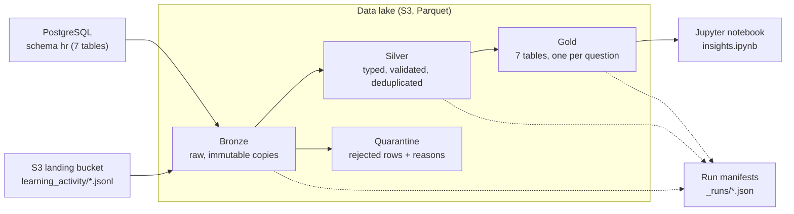

# Coding Workshop - Data Engineering

## Overview

This folder contains the data engineering jobs. The job is **[`talent-pipeline`](./talent-pipeline/)**, a batch
ETL job that builds a **medallion data lake**
(Bronze → Silver → Gold) for ACME Inc.'s performance and talent data, plus a Jupyter notebook that
answers the business questions from the curated Gold layer.

ACME cannot easily see employee performance, development progress and career growth: reviews, skills and
training records live in different systems. This pipeline brings them together and answers:

| # | Business question | Answered by (Gold table) |
|---|---|---|
| 1 | What are the performance ratings and review history for each employee? | `employee_performance_history` |
| 2 | Which employees have critical skill gaps in key competencies? | `employee_skill_gaps` |
| 3 | Who are the high-potential employees ready for promotion? | `promotion_readiness` |
| 4 | What training and development activities has each employee completed? | `employee_learning_summary` |
| 5 | Which employees are at risk of attrition based on performance trends? | `attrition_risk` |
| 6 | How does employee performance correlate with team and project outcomes? | `team_performance_outcomes` |
| 7 | What is the distribution of skills across the organization? | `skill_distribution` |

**At a glance**

| | |
|---|---|
| Sources | PostgreSQL (7 HR tables) + S3 landing bucket (783 daily JSONL files of learning events) |
| Output | 7 Gold tables in S3 (Parquet), a run manifest per run, two notebooks (business insights + lake explorer) |
| Runtime (local, full dataset) | ~8 seconds end-to-end, ~650 MB peak memory |
| Tests | 135 tests, 97 % line coverage, all four coverage targets from the guide met |
| Status | ✅ runs locally (LocalStack + PostgreSQL) · ✅ runs in AWS on EKS (run `20261015T085735Z-0e8677b4`, results identical to local) — see [Cloud Deployment](#cloud-deployment) |

Related documents:

- [LINEAGE.md](./LINEAGE.md) — source-to-target mapping: every column, rename, cast and aggregation
- [TESTING.md](./TESTING.md) — test evidence: commands, results, performance, coverage, bugs found
- [notebooks/insights.ipynb](./talent-pipeline/notebooks/insights.ipynb) — the business answers, with charts
- [notebooks/lake_explorer.ipynb](./talent-pipeline/notebooks/lake_explorer.ipynb) — a visual tour of the lake itself: every layer, lineage, quarantine, runs

## Architecture



| Layer | What it holds | Key rule |
|---|---|---|
| **Bronze** | Exact copies of the sources: one Parquet snapshot per table per day, byte-for-byte copies of the JSONL files | Never modified after writing; every copy verified (row counts, file size + checksum) |
| **Silver** | The same entities, cleaned: real types, enforced schema contracts, duplicates removed, cross-table checks | Every bad row is **quarantined with its reasons** — nothing is silently dropped. `read = silver + quarantine` is enforced |
| **Gold** | Business-ready tables, one per question, with the agreed definitions applied | Validated before publishing: unique grain, no dropped employees, totals reconcile with Silver |

## Prerequisites

- **Workshop environment** set up as in the [Validation Guide](../docs/validation.md)
  (`setup-participant.sh`, `setup-environment.sh -d`, and `PARTICIPANT_ID` / `LOCALSTACK_AUTH_TOKEN` in `~/.bashrc`)
- **Python 3.11+** (developed on 3.13; the cloud image runs 3.11 — both are tested)
- **PostgreSQL** running locally (installed by `setup-environment.sh`)
- **LocalStack** + **Docker** for local S3
- **AWS CLI** (used by the seed script)
- The **reference dataset** unzipped at `sampleData/data-engineering-performance-talent-management/`

Python packages are pinned in [requirements.txt](./talent-pipeline/requirements.txt) (what the job needs, and what the cloud
installs) and [requirements-dev.txt](./talent-pipeline/requirements-dev.txt) (tests and notebook — never deployed):

| Package | Version | Why |
|---|---|---|
| pandas | 3.0.6 | transformations (the data fits in memory; see [Design decisions](#design-decisions-and-trade-offs)) |
| pyarrow | 24.0.0 | Parquet files and S3 access with partition overwrite |
| boto3 | 1.43.100 | S3 object operations (list, copy, read) |
| psycopg2-binary | 2.9.13 | PostgreSQL source |
| numpy | 2.4.6 | supports both Python 3.11 (cloud) and 3.13 (local) |
| numexpr, bottleneck | 2.14.2, 1.6.0 | replace NumPy-1 builds pre-installed in the cloud image that crash under NumPy 2 |

## Structure

```
coding-workshop-participant/
├── data/
│   ├── README.md                        # This guide (YOU ARE HERE)
│   ├── LINEAGE.md                       # Source-to-target mapping and lineage
│   ├── TESTING.md                       # Test evidence
│   ├── _examples/                       # Workshop skeletons (not deployed: "_" prefix)
│   └── talent-pipeline/                 # The job (auto-discovered by infra/locals.tf)
│       ├── job.py                       # The whole pipeline: Bronze → Silver → Gold (single file, see below)
│       ├── requirements.txt             # Runtime dependencies — shipped to the cloud with job.py
│       ├── requirements-dev.txt         # Test + notebook dependencies — local only
│       ├── pytest.ini                   # Test configuration
│       ├── notebooks/
│       │   ├── insights.ipynb           # Business answers with charts (reads Gold)
│       │   └── lake_explorer.ipynb      # Visual tour of Bronze/Silver/quarantine/Gold, lineage and runs
│       ├── scripts/
│       │   ├── seed_sources.sh          # Loads the source systems (PostgreSQL + S3 landing)
│       │   ├── seed_aws_sources.sh      # Loads the source systems in AWS (S3 landing + Aurora, via the cluster)
│       │   ├── inspect_lake.py          # Read-only viewer: show any Bronze/Silver/Gold dataset (local or cloud)
│       │   ├── perf_test.py             # Performance tests at 1×, 5×, 20× volume
│       │   └── coverage_by_area.py      # Coverage per guide area vs targets
│       └── tests/                       # 135 tests (unit, integration, end-to-end, notebook)
│           ├── conftest.py              #   shared fixtures (throwaway S3 buckets)
│           ├── test_foundation.py       #   config, logging, retries, I/O
│           ├── test_bronze.py           #   ingestion
│           ├── test_silver.py           #   validation, cleaning, quarantine
│           ├── test_gold.py             #   business definitions
│           ├── test_lineage.py          #   lineage graph, run manifests
│           ├── test_resilience.py       #   transient failures, schema drift
│           ├── test_e2e.py              #   full pipeline + independent recomputation from raw files
│           └── test_notebook.py         #   the notebook runs against fresh Gold
├── sampleData/
│   └── data-engineering-performance-talent-management/   # Reference dataset (source data)
└── ...
```

**Why the pipeline is one file.** The workshop's Helm chart
([infra/helm/templates/python-job.yaml](../infra/helm/templates/python-job.yaml)) ships **only**
`job.py` and `requirements.txt` into the cloud container. A helper module in a second file would work locally
and fail in the cloud with `ModuleNotFoundError`. `job.py` is therefore organised in eight numbered sections:

| Section | Contents |
|---|---|
| 1. Configuration | `Settings`, read once from environment variables |
| 2. Logging | one JSON object per log line |
| 3. Run context | run id, per-step timing / CPU / memory / metrics |
| 4. Retry | exponential backoff with jitter for transient failures |
| 5. I/O | `SourceDatabase` (PostgreSQL), `Lake` (S3) |
| 6. Schema contracts & data quality | contracts, validation engine, JSONL parsing, cross-table checks |
| 7. Pipeline steps | preflight, Bronze, Silver, Gold, lineage and run manifests |
| 8. Entry point | command-line options, exit codes |

## Usage

### Local Development

These steps follow the workshop guides: [Validation Guide](../docs/validation.md) for the environment and
the [Data Engineer Guide](../docs/data-engineer.md#local-development) for running a job.
Locally, a data job runs as a normal Python process — the workshop only deploys data jobs as Kubernetes
jobs in AWS.

**1. Start the local environment** (PostgreSQL, MongoDB, LocalStack, workshop backend, frontend):

```sh
cd ~/coding-workshop-participant
source ~/.bashrc
./bin/start-dev.sh
```

Leave this terminal running (it ends by starting the frontend dev server) and open a new terminal.

> **Note:** on this VDI `start-dev.sh` restarts LocalStack every time (it expects the image name
> `localstack/localstack-pro`, the machine runs `localstack/localstack-pro:dev`). Restarting LocalStack
> **erases everything stored in it**, so always do step 2 after it.

**2. Load the source systems** (safe to repeat):

```sh
cd ~/coding-workshop-participant
./data/talent-pipeline/scripts/seed_sources.sh
```

This loads the 7 CSV files into PostgreSQL schema `hr` (using the dataset's own `load.sh`) and uploads the
783 learning-activity files to `s3://coding-workshop-landing-<PARTICIPANT_ID>/learning_activity/`.
It ends with a verification line — expect `employees=2000 … s3 objects: 783`.

**3. Create the Python environment** (first time only):

```sh
cd ~/coding-workshop-participant/data/talent-pipeline
python3 -m venv .venv
.venv/bin/pip install -r requirements-dev.txt
.venv/bin/python -m ipykernel install --user --name talent-pipeline --display-name "Python (talent-pipeline)"
```

The virtual environment keeps the pinned versions away from the rest of the machine (a plain `pip install`
would, for example, downgrade NumPy for every other Python tool).

**4. Run the job** (the Data Engineer Guide's commands, inside the virtual environment):

```sh
cd ~/coding-workshop-participant/infra
source ../data/talent-pipeline/.venv/bin/activate
pip install -r ../data/talent-pipeline/requirements.txt
python ../data/talent-pipeline/job.py 2>&1 | tee /tmp/talent-pipeline.log
```

**What success looks like:** about 8 seconds of JSON log lines, ending with
`"msg": "run finished", … "status": "succeeded"`, and exit code `0` (`echo $?`).
The expected warnings are data-quality findings, not errors (see [Data quality findings](#data-quality-findings)):

```
WARNING  landing file is empty (0 bytes): possible failed or partial delivery   (1 file)
WARNING  records dated before the employee's hire date (flagged, kept)          (reviews, assessments, events)
WARNING  schema drift: field renamed by source, mapped to canonical name        (notes -> text)
WARNING  silver entity written … quarantined: 294                               (learning_events)
```

**Useful options:**

```sh
python job.py --steps silver,gold      # re-run later steps only (Bronze must exist for today)
RUN_DATE=2026-10-01 python job.py      # re-run a past day exactly (backfill)
LOG_LEVEL=DEBUG python job.py          # more detail
python job.py | jq 'select(.level != "INFO")'   # only warnings and errors
```

| Exit code | Meaning |
|---|---|
| `0` | success |
| `1` | a step failed (details in the log and in the run manifest) |
| `2` | invalid configuration (the message lists every missing setting) |

**5. Look at the results.** Open [notebooks/insights.ipynb](./talent-pipeline/notebooks/insights.ipynb) in VS Code, pick the
kernel **Python (talent-pipeline)** and use **Run All**. To look up one employee, go to section 8 and edit the
two lines under `EDIT HERE` (`EMPLOYEE_ID = 1332`, or `SEARCH_NAME = "Davis"` to search by name).
Both notebooks read LocalStack by default; to read the **AWS** lake from VS Code instead, run
`./bin/setup-participant.sh` (fresh keys) and set `FORCE_LOCAL = False` in the first code cell's `EDIT HERE` block.

To **see the lake itself** — what each layer looks like, the lineage diagram, row accounting, quarantine, one
employee traced through every layer, and the run history — open
[notebooks/lake_explorer.ipynb](./talent-pipeline/notebooks/lake_explorer.ipynb) the same way and **Run All**. Its
section 7 browses any dataset (edit `DATASET` / `FILTERS` under `EDIT HERE`); section 8 follows one employee.

From a terminal, to **show any layer's data** (Bronze, Silver, Gold, quarantine, run manifests), use the read-only viewer —
it prints where the dataset lives, its row count, columns with types, and the first rows:

```sh
cd ~/coding-workshop-participant/data/talent-pipeline
.venv/bin/python scripts/inspect_lake.py --list                          # every dataset with row counts
.venv/bin/python scripts/inspect_lake.py silver/employees                # one dataset (LocalStack)
.venv/bin/python scripts/inspect_lake.py bronze/postgres/teams --cloud   # the same, in real AWS
.venv/bin/python scripts/inspect_lake.py bronze/learning_activity        # raw JSONL lines
.venv/bin/python scripts/inspect_lake.py quarantine/learning_events --rows 10
```

Parquet files (Bronze tables, Silver, Gold) are binary, so `aws s3 cp … -` or the S3 console can't show their
rows — the viewer (or the notebook) can. To list the raw files instead:

```sh
export AWS_ACCESS_KEY_ID=test AWS_SECRET_ACCESS_KEY=test
aws --endpoint-url http://localhost.localstack.cloud:4566 s3 ls s3://coding-workshop-datalake-$PARTICIPANT_ID/ --recursive
```

**6. Run the tests:**

```sh
cd ~/coding-workshop-participant/data/talent-pipeline
.venv/bin/pytest -q                              # all 135 tests, ~55 s (needs steps 1-2)
.venv/bin/pytest -q -m "not integration"         # 103 unit tests, ~5 s (no services needed)
.venv/bin/python scripts/perf_test.py --scales 1 5 20   # performance tests (local only)
```

### Cloud Deployment

> **Status: deployed and verified.** The cloud run `20261015T085735Z-0e8677b4` (2026-10-15) succeeded on EKS
> (Python 3.11.6, ~34 s, peak 644 MB of the pod's 2 GiB) and matched the local run on every data metric.
> The steps below reproduce it by hand. It creates billable AWS resources (an EKS cluster
> and Aurora PostgreSQL) — run the clean-up steps when finished.

The workshop deploys a data job as a Kubernetes job on Amazon EKS
([Data Engineer Guide](../docs/data-engineer.md#cloud-deployment)). Terraform finds this job automatically
(`data/*/requirements.txt` in [infra/locals.tf](../infra/locals.tf)) and Helm runs it in the
`jupyter/all-spark-notebook` image (Python 3.11, 1 CPU, 2 GiB) as
`pip install -r requirements.txt && python job.py`.

**What was changed in `infra/` to make the job work in the cloud** (all AWS-only; the local deploy is unchanged —
`terraform plan` against LocalStack shows *No changes*):

| Problem found | Fix | File |
|---|---|---|
| The Helm job received **no environment variables**, so `job.py` stopped with exit code 2 | Data jobs now get the backend's database settings (`local.env_vars`) plus `AWS_REGION`, `LANDING_BUCKET`, `DATALAKE_BUCKET`. The password goes into a Kubernetes **Secret** (`envFrom`), never into the Job definition | [infra/eks.tf](../infra/eks.tf), [helm/values.yaml](../infra/helm/values.yaml), [helm/templates/python-job.yaml](../infra/helm/templates/python-job.yaml) |
| The EKS node role (which the pod runs as) had **no S3 permissions** — only the standard EKS policies | A least-privilege inline policy on that role: **read-only** on the landing bucket, read/write on the data-lake bucket. (Per-pod "Pod Identity" would be tighter, but the participant role may not create pod-identity associations.) | [infra/eks.tf](../infra/eks.tf) |
| Pods couldn't **reach Aurora**: worker nodes sit in the EKS-created cluster security group, while Aurora only accepted traffic from its own `coding-workshop-<id>` group (connections hung). The participant role may not add security-group rules | Aurora also joins the EKS cluster security group (when EKS is enabled), whose built-in rule allows all traffic between its members — in-place change, no restart | [infra/rds.tf](../infra/rds.tf) |
| The pod got `NoCredentialsError`: nodes enforce IMDSv2 with **hop limit 1**, so pods can't fetch the node role's credentials from the instance metadata service (the node group has no launch template; per-pod IAM isn't allowed for the participant role) | The data-job pod runs with `hostNetwork: true` (+ `dnsPolicy: ClusterFirstWithHostNet`), putting it 0 hops from the metadata service. No extra permissions: it gets exactly the node role's | [infra/helm/templates/python-job.yaml](../infra/helm/templates/python-job.yaml), [infra/eks.tf](../infra/eks.tf) |
| JupyterHub notebook servers would hit the same two walls: no lake settings, and no credentials (IMDS hop limit 1 — plus JupyterHub's own default **firewall block of the metadata service**, which with host networking would land on the *node's* firewall and cut off the whole node) | Notebook servers get `IS_LOCAL`, `AWS_REGION`, `DATALAKE_BUCKET`, host networking, and `cloudMetadata.blockWithIptables: false`. Trade-off: notebook users get the node role's permissions — acceptable here because only your participant group can log in; one notebook server per node (port 8888 on the host) | [infra/helm/config.yaml](../infra/helm/config.yaml), [infra/eks.tf](../infra/eks.tf) |
| Aurora starts **empty** and is not reachable from the VDI | [scripts/seed_aws_sources.sh](./talent-pipeline/scripts/seed_aws_sources.sh) loads the source data from **inside** the cluster | — |

#### Step-by-step

Run from the repository root (`~/coding-workshop-participant`), in a normal terminal.

**1. Enable EKS and deploy** (~15–25 minutes; creates the cluster, Aurora, JupyterHub and the job):

```sh
echo "export TF_VAR_aws_eks_enabled=true" >> ~/.bashrc
source ~/.bashrc
./bin/deploy-backend.sh                 # no argument = AWS
```

The job starts straight away and **fails on purpose** — the source data isn't in AWS yet
(the landing bucket doesn't exist, so preflight stops). That's expected.

**2. Load the source data into AWS** (landing bucket + Aurora `hr` schema):

```sh
./data/talent-pipeline/scripts/seed_aws_sources.sh
```

Expect `objects: 783` for S3 and, at the end, `teams=100 … employees=2000 … talent_review=2000`.

**3. Run the pipeline again.** Delete the failed job first — if it still exists, Helm sees "no change" and
won't start a new one:

```sh
kubectl delete job coding-workshop-talent-pipeline --ignore-not-found
./bin/deploy-backend.sh
kubectl logs -f job/coding-workshop-talent-pipeline
```

Success looks the same as locally: JSON log lines ending in `"msg": "run finished", … "status": "succeeded"`.
Check the job: `kubectl get jobs` (COMPLETIONS `1/1`).

**4. Check the output in S3:**

```sh
aws s3 ls s3://coding-workshop-datalake-$PARTICIPANT_ID/gold/ --recursive
aws s3 cp s3://coding-workshop-datalake-$PARTICIPANT_ID/_runs/latest.json -
```

Optionally, run the notebook on the cluster's JupyterHub. Its proxy is internal to the cluster
(`ClusterIP` in [infra/helm/config.yaml](../infra/helm/config.yaml)), so reach it through a port-forward:

```sh
kubectl port-forward svc/proxy-public 8888:80     # then open http://localhost:8888 and log in (workshop LDAP account)
```

Upload `notebooks/insights.ipynb` (and/or `notebooks/lake_explorer.ipynb`) and **Run All**. On JupyterHub the notebooks switch to cloud mode by itself
(JupyterHub sets `JUPYTERHUB_USER`) and looks up the bucket's region; if it can't tell which bucket to read, it says so
— set `DATALAKE_BUCKET` in the *EDIT HERE* block of the first code cell (normally not needed: the deploy passes
it to notebook servers). Tested in the JupyterHub image (pandas 2.0.3) against this deployment's real Gold data:
all 8 charts, no errors (and the lake explorer: all 6 — [TESTING.md §4.4](./TESTING.md)). After a deploy that changes JupyterHub settings, stop and start your notebook server
(*File → Hub Control Panel → Stop My Server*) so it picks them up.

**5. Clean up** (stops the charges):

```sh
aws s3 rb s3://coding-workshop-datalake-$PARTICIPANT_ID --force   # created by the job, not by Terraform
aws s3 rb s3://coding-workshop-landing-$PARTICIPANT_ID --force    # created by seed_aws_sources.sh
./bin/cleanup-environment.sh                                       # terraform destroy of the AWS infrastructure
```

`cleanup-environment.sh` first uploads a zip backup of the whole project (including `ENVIRONMENT.config`)
to your workshop S3 bucket, then destroys everything Terraform created — including the IAM policy added
above (the organizers' role itself stays). Set `TF_VAR_aws_eks_enabled` back to `false` in `~/.bashrc`
afterwards if you don't want EKS on later deploys.

**If something fails**

| Symptom (in `kubectl logs`) | Meaning | What to do |
|---|---|---|
| `invalid configuration … Missing required environment variables` (exit 2) | The job didn't get its settings | Check `kubectl get secret coding-workshop-talent-pipeline-env` exists and `kubectl describe job …` shows the `env:` list |
| `transient failure, retrying … postgres connect` then `giving up` | Aurora unreachable (or still resuming from pause) | Re-run step 3 after a minute; check the job and Aurora share the `coding-workshop-<id>` security group |
| `PermissionError: access denied to s3://…` | The node role lacks S3 access | Check the inline policy `coding-workshop-eks-data-jobs-s3-<id>` exists on role `coding-workshop-eks-<region>-<id>` |
| `404` for the landing bucket at preflight | Step 2 not done | Run `seed_aws_sources.sh`, then step 3 |
| Pod `OOMKilled` | Memory above 2 GiB | Not expected at today's volume (peak ~0.65 GB); see TESTING.md §4.1 |

## Configuration

All settings come from environment variables — the same names the workshop injects into backend services
([backend/README.md](../backend/README.md)). Nothing environment-specific is hard-coded.

| Variable | Local default | Cloud | Purpose |
|---|---|---|---|
| `IS_LOCAL` | `true` | `false` | Local (LocalStack, dummy credentials) vs AWS |
| `POSTGRES_HOST` / `PORT` / `NAME` / `USER` / `PASS` | `localhost` / `5432` / `postgres` / `postgres` / `postgres123` (from [infra/locals.tf](../infra/locals.tf)) | **required** | Source database. TLS is required in the cloud |
| `SOURCE_SCHEMA` | `hr` | `hr` | Schema holding the 7 source tables |
| `LANDING_BUCKET` | `coding-workshop-landing-<PARTICIPANT_ID>` | **required** (or `PARTICIPANT_ID`) | Where source JSONL files arrive |
| `DATALAKE_BUCKET` | `coding-workshop-datalake-<PARTICIPANT_ID>` | **required** (or `PARTICIPANT_ID`) | The data lake (created if missing) |
| `AWS_REGION` | `us-east-1` | **required** | Region for S3 |
| `AWS_ENDPOINT_URL` | `http://localhost.localstack.cloud:4566` | (none) | LocalStack endpoint |
| `RUN_DATE` | today (UTC) | today (UTC) | Logical date of the run; set it to re-run a past day |
| `LOG_LEVEL` | `INFO` | `INFO` | Log detail |

Empty values count as "not set" (the workshop injects some as empty strings locally). Locally the job
always uses dummy `test` credentials, so real AWS keys in your shell are never sent anywhere.

## Data Lake Layout

```
s3://coding-workshop-datalake-<PARTICIPANT_ID>/
├── bronze/
│   ├── postgres/<table>/ingest_date=YYYY-MM-DD/part-0.parquet       # one snapshot per table per day
│   └── learning_activity/year=YYYY/month=MM/day=DD/events-000.jsonl  # raw byte copies of the landing files
├── silver/
│   ├── <table>/part-0.parquet                                         # 7 validated source tables
│   ├── dim_employee/part-0.parquet                                    # employee + team + department
│   └── learning_events/event_year=YYYY/event_month=M/part-0.parquet   # partitioned by month
├── quarantine/<entity>/run_date=YYYY-MM-DD/part-0.parquet             # rejected rows + reject_reason
├── gold/<table>/part-0.parquet                                        # 7 business tables
└── _runs/
    ├── run_date=YYYY-MM-DD/<run_id>.json                              # one manifest per run (failed runs too)
    └── latest.json                                                    # last COMPLETE successful run
```

## How the Pipeline Works

### Preflight

Before touching any data the job checks that PostgreSQL answers, the landing bucket exists, and the lake
bucket exists (creating it if needed). Failing early gives a clear error instead of a half-finished run.

### Bronze — raw ingestion

- **PostgreSQL:** all 7 tables are read in **one read-only, consistent snapshot** (a single
  `REPEATABLE READ` transaction), so a change in the source mid-read can't produce, for example, a review
  whose employee is missing. Values and types are stored exactly as the source returns them.
- **Learning files:** copied **byte-for-byte** with a server-side S3 copy, 16 in parallel. Every copy is
  verified (size + checksum). Lineage is stored as S3 object metadata (run id, source, time).
- **Incremental and safe to repeat:** files already in Bronze with the same checksum are skipped (a second run
  copies 0 of 783 files); table snapshots for the same day are replaced, earlier days are kept.
- **Bronze is never overwritten:** if a landing file changes after ingestion, the original is kept and a
  warning is logged. Files that break the `year=/month=/day=` layout are skipped with a warning; empty files
  are ingested but warned about.

### Silver — cleaning and validation

Every entity has a **schema contract**: column types, required fields, allowed values, ranges, formats and
unique keys. A single validation engine enforces them:

- **Strict types:** `"yesterday"` or `"2026-13-45"` is rejected, never guessed.
- **Every reason recorded:** a rejected row carries *all* its problems, e.g. `bad_format_review_period;out_of_range_rating`.
- **Quarantine, don't drop:** rejected rows go to `quarantine/` with the original record and its exact source
  file and line. Each run checks `rows read = Silver rows + quarantined rows` and fails if they differ.
- **Foreign keys** are checked against *valid* parents, so every join in Gold finds its match.
- **Duplicates:** the first valid occurrence wins (deterministic: files in sorted order, lines in file order).
- **Known schema drift** is mapped (`notes` → `text` in one file) and logged.
- **Cross-table consistency:** reviews, assessments and learning events dated **before the employee's hire
  date** are **flagged, not dropped** (`recorded_before_hire`) — see [Data quality findings](#data-quality-findings).
- **Structural problems stop the run safely:** if a source table loses a column, its snapshot is quarantined,
  an alert is logged, and the run stops **before** Silver or Gold are touched, so readers keep the last good
  data. A single landing file with a different schema is quarantined on its own and the rest continue.

### Gold — business answers

Gold is computed from Silver by pure functions (no I/O), each registered with the inputs it uses. The
pipeline validates everything before publishing anything: unique grain per table, no employee dropped,
and totals that reconcile with Silver. Every Gold row carries `_run_id` and `_as_of_date`.

**Business definitions** (named constants in `job.py`, agreed before building — change them there only):

| Concept | Definition |
|---|---|
| Critical skill gap (Q2) | assessed proficiency **2 or more levels** below the required level (`CRITICAL_GAP_LEVELS = 2`) |
| Promotion tiers (Q3) | `ready_strong` = potential *High* + *Ready Now* + latest rating **≥ 4** · `ready` = *High* + *Ready Now* · `pipeline` = *High* + *1–2 Years* · otherwise `not_ready` |
| High performer (Q3, Q6) | latest rating ≥ 4 (`STRONG_RATING = 4`) |
| Performance risk (Q5) | rating fell **2+** levels → High · fell 1 → Medium · flat or up → Low · fewer than 2 reviews → Unknown |
| Combined attrition risk (Q5) | the higher of HR's label and the performance risk; *hidden risk* = HR says Low but performance risk is High |
| Recent learning (Q4, Q5) | events in the last 180 days before the run date (`LEARNING_RECENT_DAYS = 180`) |

**Results on the reference dataset** (latest run): 4,000 review-history rows, 4,000 skill-gap rows,
2,000 employees in each employee-level table, 100 teams, 400 competency × department rows.
Highlights: 325 critical gaps across 317 employees · 166 strong promotion candidates (+191 ready, 137 pipeline) ·
6 hidden-risk employees · team rating vs project outcome r = 0.24, not statistically reliable (p = 0.22,
only 27 teams have projects). The notebook explains each answer.

## Data Quality Findings

The source data contains deliberate and accidental problems. How each is handled:

| Finding | Scale | Handling |
|---|---|---|
| Duplicate learning events | 151 | quarantined (`duplicate_event_id`), first copy kept |
| Events with no employee | 76 | quarantined (`missing_employee_id`) |
| Unparseable dates (`yesterday`, `N/A`, `2026-13-45`) | 39 | quarantined (`bad_type_event_ts`) |
| Empty dates | 15 | quarantined (`missing_event_ts`) |
| Truncated (malformed) JSON lines | 13 | quarantined (`malformed_json`) |
| Field renamed in one file (`notes` instead of `text`) | 39 rows, 1 file | mapped to `text`, logged as schema drift |
| Empty landing file (`2025-09-03`) | 1 file | ingested, warned about (possible failed delivery) |
| Records dated before the employee's hire date | 666 reviews (17 %), 234 assessments (6 %), 5,161 events (17 %) | **flagged and kept** — the data can't show whether the record or the hire date is wrong; open question for the HR data owner. The notebook shows each answer with and without them |
| `employee_id` is text in events, integer in PostgreSQL | all events | converted to integer |
| Course completions without an enrollment | 3,255 of the 3,421 employee–course pairs with a completion have no enrollment event | no completion-rate metric is reported (it would be misleading) |
| Quiz pass mark | passes range 55–100 | not an error — the pass mark is 55 (an earlier assumption of 60 was checked and dropped) |

In total 294 of 29,868 learning-event lines (1 %) are quarantined; all 12,173 PostgreSQL rows pass.

## Observability and Lineage

- **Logs:** one JSON object per line on standard output (what `kubectl logs` and CloudWatch collect), each
  stamped with the `run_id`. Every step logs rows read / written / quarantined, duration, CPU time and peak memory.
- **Alerts:** log lines that need a human carry `"alert": true` (retries exhausted, schema mismatch, failed run).
- **Retries:** connection problems are retried 5 times with exponential backoff and jitter (PostgreSQL, S3);
  permanent errors (wrong password, access denied) fail immediately with a clear message.
- **Run manifest** (`_runs/…/<run_id>.json`): status, every step's metrics and errors, the SHA-256 of `job.py`,
  Python and package versions, configuration (never secrets) and the full dataset lineage graph.
  `_runs/latest.json` only moves after a complete successful run, so consumers never read a failed run.
- **Row lineage:** `_run_id`, `_source`, `_source_file` / `_source_line` and other `_` columns trace any row back
  to its source record. Full details: [LINEAGE.md](./LINEAGE.md).

## Testing

135 tests cover every testing expectation in the [Data Engineer Guide](../docs/data-engineer.md#testing-expectations):

| Guide expectation | Where |
|---|---|
| Source ingestion, transformation, aggregation, data-quality and idempotency validation | `test_bronze`, `test_silver`, `test_gold`, `test_e2e` |
| Aggregations vs known expected values | `test_e2e` recomputes Gold from the **raw files with plain pandas** (no pipeline code) |
| Retry/backoff for transient PostgreSQL and S3 failures | `test_resilience`, `test_foundation` |
| Throughput, scale, resource usage, SLA | `scripts/perf_test.py` — 20× volume (840 k records) in 23 s |
| Coverage goals | 98.0 % / 98.6 % / 98.4 % / 100 % vs targets 80 / 90 / 85 / 95 % |

Full commands, results and conclusions: [TESTING.md](./TESTING.md).

## Design Decisions and Trade-offs

| Decision | Why | Trade-off |
|---|---|---|
| **pandas, not Spark** | 14 MB of data; Spark's start-up and scheduling would cost more than the processing. The guide recommends Python/pandas | Single machine; the job's memory grows with event history (safe up to ~25× today's volume in the 2 GiB pod) |
| **One `job.py` file** | The cloud deploy ships only `job.py` + `requirements.txt`, so a separate utility module would not reach the cluster | A long file — kept navigable with eight numbered sections. The shared helpers the guide asks to reuse (database connection, S3 I/O, schema contracts, logging, retry) are self-contained sections, ready to move into a shared module once a second job exists and the Helm chart can ship it |
| **Parquet, without Iceberg/Delta** | Typed, compressed, columnar; partition overwrite makes reruns duplicate-free | No table transactions or time travel; not needed at this size |
| **Silver rebuilt in full each run** | Simplest way to be always correct and idempotent; ~4 s | Cost grows with total history; at scale, process only new Bronze files |
| **Quarantine instead of drop** | Bad data stays inspectable; counts reconcile | Quarantine needs periodic review |
| **Flag records dated before hire, don't drop** | We can't tell which date is wrong | Consumers must decide; the notebook shows both views |
| **Separate landing and lake buckets** | The source system owns its bucket; the lake only reads it | One more bucket to manage |
| **Business rules as named constants** | Agreed definitions in one visible place | Changing a definition changes historical answers on rerun |

## Known Limitations

- **Two review periods only** (2024-H2, 2025-H1) — the rating "trend" is one change, an early-warning signal
  rather than a long-term trajectory. Learning data covers ~3 years, assessments 1 year.
- **Records dated before hire** (~17 % of reviews and events) are unresolved until the meaning of `hire_date` is confirmed.
- **Small project sample** — 33 projects across 27 of 100 teams, so Q6 can't establish a relationship.
- **Memory** grows with event history (Silver is rebuilt in full); see [TESTING.md §4.1](./TESTING.md).
- **JupyterHub not used** — its LDAP login fails for this account (an environment issue), and its settings change
  (`infra/helm/config.yaml`) is committed but not deployed. Both notebooks run from VS Code against the AWS lake
  instead, and were tested in the JupyterHub image ([TESTING.md §4.4](./TESTING.md)).
- **S3 access comes from the EKS node role**, so every pod on the node shares the lake permissions — per-pod roles
  (Pod Identity) would be tighter, but aren't allowed for the participant role.
- The dataset is synthetic.

## Troubleshooting

| Symptom | Cause | Fix |
|---|---|---|
| `preflight` fails: landing bucket not found (`404`) | LocalStack was restarted (e.g. by `start-dev.sh`) and lost its data | `./data/talent-pipeline/scripts/seed_sources.sh`, then re-run the job |
| `preflight` fails: `connection refused` after 5 attempts | PostgreSQL is not running | `pg_isready`; start it with `./bin/start-dev.sh` |
| Exit code `2`, "Missing required environment variables" | Cloud mode (`IS_LOCAL=false`) without settings, or `PARTICIPANT_ID` not set | Set the listed variables, or `source ~/.bashrc` |
| `run the bronze step for RUN_DATE=… first` | `--steps silver,gold` on a day with no Bronze snapshot | Run the full job, or use the right `RUN_DATE` |
| `PermissionError: access denied to s3://…` | IAM role or bucket name outside the allowed pattern | Bucket names must contain `coding-workshop` and your participant id |
| Notebook: "The data isn't loaded yet" | Lookup cell run before the Setup cell | Run the first Setup cell (or Run All) |
| Notebook: `FileNotFoundError: Path does not exist '…/_runs/latest.json'` | No complete successful run in this lake yet (or LocalStack was restarted) | Run `seed_sources.sh` if needed, then `job.py` |
| `ModuleNotFoundError` | Not using the project's virtual environment | `source data/talent-pipeline/.venv/bin/activate` |
| Long NumPy tracebacks mentioning `_ARRAY_API` (cloud image) | Image ships NumPy-1 builds of numexpr/bottleneck | Already fixed by the pins in `requirements.txt` |

## Clean Up

Local data lives in LocalStack, which is wiped whenever it restarts, and in the PostgreSQL `hr` schema.

```sh
# stop the frontend and proxy started by start-dev.sh
kill $(lsof -ti:3000) $(cat /tmp/proxy-server.pid)

# remove the source tables (they can be re-created with seed_sources.sh)
PGPASSWORD=postgres123 psql -h localhost -U postgres -c "DROP SCHEMA IF EXISTS hr CASCADE"

# stop LocalStack (erases the landing bucket and the data lake)
localstack stop
```

**Warning:** do **not** use `./bin/cleanup-environment.sh` for local clean-up. It has no local mode: it
uploads a zip of the whole project (including `ENVIRONMENT.config`, which holds AWS credentials) to your
S3 bucket in **real AWS** and then runs `terraform destroy` against your **AWS** infrastructure.

**Warning:** `./bin/deploy-backend.sh` without an argument deploys to **AWS**. For local use always add `local`
(or let `./bin/start-dev.sh` call it).
